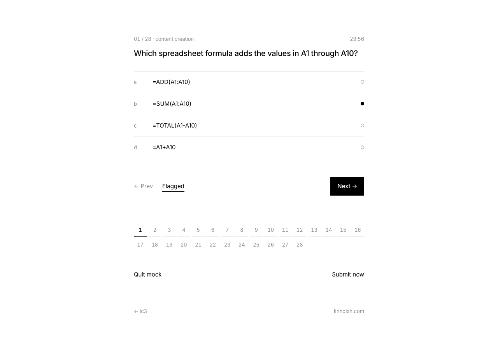

# ic3

IC3 Digital Literacy practice: a timed mock exam, practice by domain, and a short study plan.

**Live:** https://ic3.knhdixh.com



## Features

| | |
|---|---|
| mock exam | 28 questions balanced across all seven GS6 domains, 30-minute timer, flags, question map, scored out of 1000 |
| practice | one domain at a time, instant feedback and an explanation for every answer |
| results | pass / not yet, per-domain breakdown (weakest first), review of every missed question |
| what to do | six concrete steps from first mock to exam day |

Keyboard: `a`–`f` pick an answer, `←` `→` move between questions. Progress and an in-progress mock are kept in the browser (localStorage), so a reload resumes where you left off. Nothing is sent to a server.

## Stack

Cloudflare Workers with static assets. Plain HTML, CSS and ES modules, no framework or build step. Styled after the knhdixh cookbook: Inter, black on white, WebGL water cursor trail.

- `public/questions.js`: the question bank (`a` is the correct index, or an array for "choose two")
- `public/quiz.js`: exam building, scoring, timer formatting (shared with the tests)
- `public/app.js`: hash router and views
- `src/worker.js`: serves assets, redirects `*.workers.dev` to the custom domain

## Run locally

```bash
npm install
npm test
npx wrangler dev --port 8787
```

## Deploy your own

```bash
npx wrangler login
npm run deploy
```

Change or remove `routes` and `CANONICAL_HOST` in `wrangler.jsonc` to use your own domain. No secrets are needed.

## Limitations

- Original practice questions, not real exam items; 47 questions in total.
- The 1000-point score is a linear stand-in for Certiport's scaled score.
- No task-based (simulation) items. Practise those in the real apps; see "what to do".
